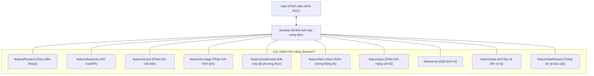

# HỆ THỐNG PHÁT HIỆN THÔNG TIN SAI LỆCH ĐA PHƯƠNG THỨC TRÊN MẠNG XÃ HỘI VIỆT NAM
*(Explainable Multimodal Misinformation Detection & Social Impact Analysis)*

**Tác giả / GitHub:** [dtc245200649-hub](https://github.com/dtc245200649-hub)  
**Repository:** [https://github.com/dtc245200649-hub/SIC_2026](https://github.com/dtc245200649-hub/SIC_2026)  
**Đề tài:** Học sâu đa phương thức có khả năng giải thích trong phát hiện thông tin sai lệch và phân tích tác động xã hội trên mạng xã hội Việt Nam.

---

## 1. Giới thiệu tổng quan
Hệ thống là một nền tảng nghiên cứu kết hợp sản phẩm thực nghiệm hoàn chỉnh, có khả năng:
- **Xử lý Đa phương thức:** Tiếp nhận đồng thời Văn bản (Text), Hình ảnh (Image), Video (Keyframes), và Âm thanh (Audio).
- **Học sâu & Dung hợp (Multimodal Fusion):** PhoBERT (Text), Vision Transformer ViT (Image/Video), Whisper (Audio STT), kết hợp qua cơ chế Cross-modal Attention và Reliability-aware Gated Fusion.
- **Explainable AI (XAI):** Minh bạch hóa lý do dự đoán của mô hình qua Word Attribution, Visual Heatmap (Grad-CAM), và tỷ trọng đóng góp của từng phương thức.
- **Kiểm chứng thông tin (Fact-Checking):** Truy xuất bằng chứng từ kho tri thức báo chí chính thống (VnExpress, Tuổi Trẻ, Thanh Niên) qua RSS Feeds 24/7 và đối soát phát biểu qua Natural Language Inference (NLI).
- **Phân tích mạng xã hội (GNN):** Xây dựng đồ thị lan truyền và phân tích tác động, tốc độ lan truyền bằng Graph Neural Networks (PyG).

---

## 2. Cấu trúc thư mục dự án
```text
DUANNHOM/
├── backend/            # API Gateway & Logic nghiệp vụ (FastAPI, SQLAlchemy 2.0, Alembic)
├── ai_engine/          # Mô hình Học sâu, XAI, Fact-checking & GNN (PyTorch, PyG)
├── frontend/           # Giao diện người dùng (React, TypeScript, Vite, Tailwind CSS)
├── data/               # Dữ liệu mẫu kiểm thử, kho bằng chứng và đồ thị mô phỏng
├── docker-compose.yml  # Cấu hình containerization triển khai
└── README.md
```

---

## 3. Lộ trình phát triển (8 Giai đoạn)
- [x] **Giai đoạn 1: Khởi tạo** (Thiết kế kiến trúc, cấu trúc thư mục, môi trường Git)
- [x] **Giai đoạn 2: Backend & Database** (17 Models SQLAlchemy, Auth JWT, Khóa tài khoản > 5 lần, Seed dữ liệu)
- [x] **Giai đoạn 3: Frontend** (React + Vite + Tailwind, 12 trang chức năng phân tích & đối soát)
- [x] **Giai đoạn 4: AI Cơ bản** (PhoBERT v2 fine-tuned 1.6GB Checkpoint, ViT Patch Embedding, Keyframe Extraction, Whisper STT)
- [x] **Giai đoạn 5: AI Đa phương thức** (Cross-Modal Co-Attention, Reliability-aware Gated Fusion, Cross-Modal Inconsistency Detection)
- [x] **Giai đoạn 6: XAI Giải thích mô hình** (Token Attribution SHAP, Grad-CAM Heatmap $14\times14$ patches, Multimodal Predictive Uncertainty, Gated Fusion Weights)
- [x] **Giai đoạn 7: GNN & Lan truyền xã hội** (Cây lan truyền, GraphSAGE/GAT, Epidemic Cascade R0 tích hợp liền mạch)
- [ ] **Giai đoạn 8: Hoàn thiện & Docker** (Đóng gói Docker Compose, Test E2E)

---

## 3.1. Chi tiết Giai đoạn 6: Explainable AI (XAI) Đa phương thức
1. **Ngôn ngữ (Text XAI):**
   - **Local Feature Attribution:** Bôi màu nhiệt trọng số ảnh hưởng của từng token theo phổ rủi ro tin giả.
   - **Shapley Values (SHAP):** Bảng xếp hạng các cụm từ kích động then chốt (+SHAP tăng nguy cơ sai sự thật, -SHAP củng cố tin chuẩn mực).
2. **Thị giác (Visual XAI):**
   - **Grad-CAM Attention Map:** Phân tích lưới 196 patches ($14\times14$) từ Vision Transformer (ViT-Base-Patch16-224).
   - **Tampering Anomaly Detection:** Tự động phát hiện bất thường cục bộ do can thiệp cắt ghép ảnh (Image Splicing) và xuất Bounding Box vùng nghi vấn.
3. **Hợp nhất & Lập luận đa phương thức (Multimodal Fusion Explainer):**
   - **Phân rã trọng số đóng góp (Gated Modality Weights):** Tính toán độ tin cậy và phân bổ trọng số động giữa PhoBERT v2, ViT và GNN.
   - **Độ bất định suy luận (Predictive Uncertainty):** Lượng hóa độ bất định dựa trên biên độ tự tin dự đoán ($U = 1 - |\text{confidence} - 0.5| \times 2$).
   - **Giải thích mâu thuẫn chéo (Cross-Modal Inconsistency):** Sinh tóm tắt lý do tự nhiên bằng tiếng Việt khi phát hiện sự bất đối xứng giữa nội dung bài viết và hình ảnh minh họa.
4. **API Endpoints:**
   - `POST /api/v1/analysis/multimodal`: Phân tích kết hợp ảnh + văn bản với đầy đủ báo cáo giải thích XAI.
   - `POST /api/v1/analysis/xai/explain`: Truy vấn độc lập báo cáo SHAP, Grad-CAM và độ bất định.

---

## 4. Cấu trúc Phân nhánh Git (Git Branching Strategy)

Dự án áp dụng mô hình chuẩn **Git Flow** với 5 loại nhánh chính:

| Nhánh (*Branch*) | Mục đích |
| :--- | :--- |
| `main` | Phiên bản chính thức, ổn định (*Production-ready*) |
| `develop` | Tích hợp các chức năng đang phát triển |
| `feature/*` | Phát triển các chức năng mới theo từng module độc lập |
| `fix/*` | Sửa lỗi phát sinh trong quá trình thử nghiệm |
| `release/*` | Chuẩn bị và đóng gói phiên bản phát hành |



### Hướng dẫn chuyển đổi nhánh làm việc:
```bash
# Xem danh sách tất cả các nhánh
git branch -a

# Chuyển sang nhánh phát triển bất kỳ:
git checkout develop
git checkout feature/frontend
git checkout feature/backend
git checkout feature/multimodal
```
